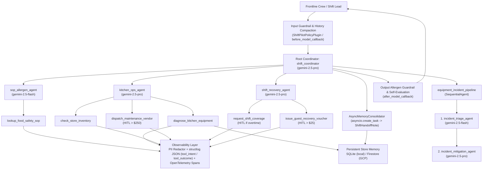

# ShiftPilot QSR — Frontline Worker Operations Agent (`qsr-frontline-ops-agent`)

A production-grade, root-level **Google ADK (Python)** multi-agent operations copilot for **ShiftPilot QSR** (fictional quick-service restaurant brand) engineered to satisfy all **19 criteria (95/95)** of the **AgentOps Code Review Matrix**.

## Architecture



## Quick Start

### 1. Local Setup

```bash
git clone https://github.com/gloyoo-hash/qsr-frontline-ops-agent.git
cd qsr-frontline-ops-agent
python3 -m venv .venv
source .venv/bin/activate
pip install -r requirements.txt
cp .env.example .env
# Add your GOOGLE_API_KEY in .env (never commit .env)
```

### 2. Run Tests, Linter & Golden Evaluations

```bash
ruff check shiftpilot_agent tests evals
pytest -v
python -m evals.run_evals --strict
```

### 3. Run with Google ADK CLI

```bash
adk web .
# or interactive CLI:
adk run shiftpilot_agent
```

### 4. Deploy to Google Cloud Run (Terraform)

```bash
cd terraform
terraform init
terraform plan -var="project_id=YOUR_GCP_PROJECT_ID"
terraform apply -var="project_id=YOUR_GCP_PROJECT_ID"
```

---

## AgentOps Code Review Matrix — 19/19 Traceability Table

| # | Pillar | Criterion | Verifiable Implementation File(s) |
|---|--------|-----------|-----------------------------------|
| 1 | **Tool & Interface Design** | Comprehensive Tool Docstrings (Google-style: purpose, args, returns, edge cases) | `shiftpilot_agent/tools/sop_tools.py`, `shiftpilot_agent/tools/equipment_tools.py`, `shiftpilot_agent/tools/inventory_tools.py`, `shiftpilot_agent/tools/shift_tools.py` |
| 2 | **Tool & Interface Design** | Descriptive Verb-First Naming (`lookup_food_safety_sop`, `diagnose_kitchen_equipment`, `check_store_inventory`, `dispatch_maintenance_vendor`, `request_shift_coverage`, `issue_guest_recovery_voucher`) | `shiftpilot_agent/tools/__init__.py`, `shiftpilot_agent/tools/*.py` |
| 3 | **Tool & Interface Design** | Explicit JSON Schemas (Strict Pydantic v2 input & output models) | `shiftpilot_agent/schemas/models.py` |
| 4 | **Tool & Interface Design** | Guided Error Handling (`status="error"`, `error_code`, `recovery_instructions`, zero crashes) | `shiftpilot_agent/tools/base.py`, `shiftpilot_agent/schemas/models.py` |
| 5 | **Context & Memory** | Robust System Instructions ("Constitution" prompt: persona, zero-guessing allergen rule, hospitality tone, boundaries) | `shiftpilot_agent/prompts.py` |
| 6 | **Context & Memory** | History Compaction (Sliding window + token/turn summarization + ADK `before_model_callback`) | `shiftpilot_agent/memory/compaction.py` |
| 7 | **Context & Memory** | Persistent Session State (SQLite local / Firestore cloud tracking store ID, recurring faults, shift handoff notes) | `shiftpilot_agent/memory/store_backend.py` |
| 8 | **Context & Memory** | Async Memory Operations (`asyncio.create_task` background shift handoff consolidation) | `shiftpilot_agent/memory/async_consolidator.py` |
| 9 | **Orchestration & Logic** | Multi-Agent Patterns (Root `shift_coordinator` + `sop_allergen_agent`, `kitchen_ops_agent`, `shift_recovery_agent`, `equipment_incident_pipeline` `SequentialAgent`) | `shiftpilot_agent/agent.py` |
| 10 | **Orchestration & Logic** | Strategic Model Routing (`gemini-2.5-flash` for fast SOP/triage lookups; `gemini-2.5-pro` for complex troubleshooting, recovery, and coordination) | `shiftpilot_agent/config.py`, `shiftpilot_agent/agent.py` |
| 11 | **Orchestration & Logic** | Guardrails & Policy Plugins (Input injection/off-topic filter, output allergen safety check, self-evaluation callback, ADK `BasePlugin`) | `shiftpilot_agent/guardrails/policy_plugin.py` |
| 12 | **Orchestration & Logic** | Human-in-the-Loop (HITL) Hooks (`PENDING_MANAGER_APPROVAL` token for maintenance > $250, vouchers > $25, overtime coverage) | `shiftpilot_agent/tools/base.py`, `shiftpilot_agent/tools/equipment_tools.py`, `shiftpilot_agent/tools/shift_tools.py` |
| 13 | **Observability & Tracing** | Structured JSON Logging (`structlog` JSON with `timestamp`, `trace_id`, `agent_name`, `tool_name`, `metadata`; zero `print()`) | `shiftpilot_agent/observability/logging_config.py` |
| 14 | **Observability & Tracing** | Intent vs. Outcome Capture (`event="tool_intent"` before execution, `event="tool_outcome"` with `status`, `latency_ms`, `result_summary` after) | `shiftpilot_agent/observability/logging_config.py`, `shiftpilot_agent/tools/base.py` |
| 15 | **Observability & Tracing** | Distributed Tracing (OpenTelemetry spans & context propagation across Coordinator -> Sub-Agent -> Tool) | `shiftpilot_agent/observability/tracing.py`, `shiftpilot_agent/guardrails/policy_plugin.py`, `shiftpilot_agent/tools/base.py` |
| 16 | **Observability & Tracing** | PII Redaction (Active scrubber for employee IDs, phones, emails, payment cards + optional Cloud DLP hook applied before logging & persistence) | `shiftpilot_agent/observability/pii_redactor.py` |
| 17 | **Infrastructure & CI/CD** | Automated Evaluation Suites (`pytest` unit/integration tests + `evals/golden_dataset.json` + `evals/run_evals.py`) | `tests/`, `evals/golden_dataset.json`, `evals/run_evals.py` |
| 18 | **Infrastructure & CI/CD** | Infrastructure as Code (Terraform for Cloud Run, Secret Manager, Firestore, IAM + `Dockerfile` + GitHub Actions CI) | `terraform/main.tf`, `terraform/variables.tf`, `terraform/outputs.tf`, `Dockerfile`, `.github/workflows/ci.yml` |
| 19 | **Infrastructure & CI/CD** | Secure Secret Management (Google Cloud Secret Manager + env fallback, `.env.example`, strict `.gitignore`, zero hardcoded keys) | `shiftpilot_agent/security/secrets.py`, `.env.example`, `.gitignore` |
